# WiSP —— 面向显存受限 MoE 推理的路由感知专家分页

> *WiSP 像 vLLM 分页 KV 那样分页专家——然后在固定的 GPU 预算下，决定 KV 和专家各分到多少字节。*

<p align="center">
  
</p>

> **35 秒看懂 MV-WSA** —— 在固定的 GPU 预算（iso-VRAM，等显存）下，控制器发现 KV 池大部分时间处于空闲，于是把这些字节回收给常驻专家（上限 32→35，KV 从 2.79 GiB 降到 1.53 GiB），并以**快 1.19 倍**的速度服务同一条 agent 轨迹（`db` 场景；`os` 场景为 1.07 倍），且零抢占、输出逐字节一致。测试环境为真实的 24 GiB RTX 3090（vLLM 0.11.2）。动画循环播放；交互式讲解见 [`demo/animate/`](demo/animate/)。
>
> 这就是论文中报告的 MV-WSA **在线双调节控制器**。其代码随会议发布版一同提供（见 [路线图](#路线图)）；**本次 v1** 发布的是专家分页器，以及下文中的静态 iso-VRAM 复现与逐字节一致性复现。

WiSP 是 [vLLM](https://github.com/vllm-project/vllm) 的一个即插即用插件，它让混合专家（MoE）模型能够运行在显存放不下全部专家权重的 GPU 上。常驻专家被当作缓存；其余专家按需从锁页主机内存（pinned host memory）换入，并在这个与 KV 缓存共享的单一显存预算下被换出。在 24 GiB 的 RTX 3090 上，它可以服务 `Qwen3-30B-A3B`（BF16 下约 57 GiB）——一个原本放不下的模型——在相同显存预算下，解码吞吐最高达到原生 vLLM 静态 `--cpu-offload-gb` 的 **2.0 倍**。

**在温度 0 下，解码输出与原生 vLLM 逐字节一致**（针对未量化的 fused-MoE 路径）：逐 token 的合并是按路由顺序对每个 token 被路由到的专家集合做加权求和，因此与专家占用哪个物理暂存槽位无关。WiSP 只改变权重**存放在哪里**，不改变计算。你可以用 `scripts/check_byte_identity.py` 自行验证（见下文）。

> 针对 **vLLM 0.11.2** 测试。能力断言（原生 vLLM 能/不能服务哪些模型）以该版本为准。

## 本次发布包含什么（以及不包含什么）

这是 WiSP 论文的配套工件（artifact）。它包含论文核心数据所依赖的部分：

- 作为干净 vLLM 插件的**路由感知专家分页器**——它建立在“把常驻专家视作缓存”这一已知思路上，并被封装为即插即用、逐字节精确；
- 在真实消费级显卡上的 **iso-VRAM（等显存）** 复现；
- **逐字节一致性**检查。

它**不**包含从零构建的研究用模拟器、离线上界 oracle（预言机），也不包含在线双调节控制器——这些支撑的是分析图表，超出本次 v1 的范围。

## 安装

```bash
# 1) 先安装与你的 CUDA 匹配的 torch，再安装 vLLM 0.11.2
pip install torch --index-url https://download.pytorch.org/whl/cu121
pip install vllm==0.11.2

# 2) 安装 WiSP（注册 vLLM 插件入口点）
pip install -e .
```

或使用固定版本的镜像：`docker build -t wisp . && docker run --gpus all -it wisp`。

安装完成后，插件会自动注册到 vLLM。设置 `WISP_PLUGIN_DISABLE=1` 可让其失效（便于在同一安装上做 A/B 基线对比）。

## 快速上手

### 服务化部署（兼容 OpenAI 接口）

```bash
export WISP_MODE=paged WISP_CAP_EXPERTS=8
vllm serve Qwen/Qwen3-30B-A3B --enforce-eager \
    --gpu-memory-utilization 0.45 --max-model-len 4096
```

在 24 GiB 的 GPU 上，不装插件会 OOM；装插件后，模型以约 10 GiB 加载并通过 HTTP 提供服务。

### 离线使用（Python）

```python
from wisp.integrations.vllm import install_wisp_moe
install_wisp_moe()  # 必须在 vLLM 导入模型之前调用

from vllm import LLM, SamplingParams
llm = LLM("Qwen/Qwen3-30B-A3B", enforce_eager=True, gpu_memory_utilization=0.45)
print(llm.generate(["Hello, world."], SamplingParams(temperature=0))[0].outputs[0].text)
```

## 复现论文结论

`reproduce.sh` 会在任意空闲显存 ≥ 约 16 GiB、主机内存约 80 GiB 的 CUDA GPU 上运行两项核心结果（主专家权重常驻锁页于 DRAM 中）：

```bash
bash reproduce.sh                 # 逐字节一致性 + iso-VRAM Pareto 扫描
STEP=identity bash reproduce.sh   # 仅逐字节一致性
STEP=isovram  bash reproduce.sh   # 仅 iso-VRAM 扫描
```

直接运行逐字节一致性检查：

```bash
# 原生参考实现从 CPU 流式加载权重，以便放下超过显存的模型（数学等价）
python scripts/check_byte_identity.py --mode vanilla --out vanilla.json --cpu-offload-gb 48 --gpu-memory-utilization 0.90
python scripts/check_byte_identity.py --mode wisp --cap-experts 8 --out wisp.json --gpu-memory-utilization 0.45
python scripts/check_byte_identity.py --compare vanilla.json wisp.json   # -> 逐字节一致
```

## 配置

| 环境变量 | 默认值 | 含义 |
| --- | --- | --- |
| `WISP_MODE` | `paged` | `paged` = LRU 分页（省显存）；`resident` = 全常驻（不分页）；`copy` = 朴素全量拷贝（仅用于正确性验证）。旧别名 `day2b`/`day2a`/`day1` 仍可使用。 |
| `WISP_CAP_EXPERTS` | `min(num_experts, 24)` | `paged` 模式下每层的暂存大小（常驻专家槽位数）。 |
| `WISP_PLUGIN_DISABLE` | `0` | 设为 `1` 使插件失效。 |

## 目录结构

```
src/wisp/integrations/vllm/   vLLM 插件（install_wisp_moe）
src/wisp/oracle/cooccur.py    按层条件的路由共现统计
scripts/                      复现 + 基准测试脚本
reproduce.sh                  一键复现
```

## 范围与局限

- 逐字节一致性仅保证适用于**按路由顺序合并**的**未量化 fused-MoE** 路径。量化 / DeepGEMM / atomic-reduce 内核不在保证范围内。
- WiSP 面向显存受限显卡上的**单流 / 低并发**解码。在可重叠的高批量场景下，权衡关系不同。
- 单流解码受限于 **PCIe 带宽**，而非预测能力；推测式预取是省显存的手段，不是降延迟的手段（详见论文）。
- 首次加载会把**完整专家权重（约等于模型大小）锁页到主机内存**，因此主机需要相应大小的可锁页内存，且初始加载可能很慢——尤其在网络文件系统上（我们见过从网络卷加载 57 GiB 模型耗时约 15+ 分钟）。从本地 NVMe 加载会快得多，且操作系统页缓存会让后续加载更快。这是一次性开销，不是卡死。

## 路线图

本次 v1 发布插件和两项核心复现。后续计划：

- [ ] 将逐字节一致性保证与测试扩展到量化 / FP8 fused-MoE 路径。
- [ ] 在 iso-VRAM Pareto 上与其他专家卸载服务系统做正面比较。
- [ ] 将在线 MV-WSA 双调节控制器（专家 ↔ KV）接入多进程服务循环——即上文中演示、论文中报告的控制器（相比最佳固定切分提升 1.07–1.19 倍）。
- [ ] 更广的模型与硬件覆盖（更多 MoE 家族、更多消费级 / 边缘 GPU）。

欢迎贡献代码和提交 issue。

## 许可证

Apache-2.0。

## 引用

```bibtex
@misc{zhang2026wisp,
  title         = {WiSP: A Working-Set View of Mixture-of-Experts Serving on Extremely Low-Resource Hardware},
  author        = {Jiamu Zhang and Liang Wu and Mayank Darbari and Liangjie Hong},
  year          = {2026},
  eprint        = {2606.21868},
  archivePrefix = {arXiv},
  primaryClass  = {cs.LG},
  doi           = {10.48550/arXiv.2606.21868},
  url           = {https://arxiv.org/abs/2606.21868}
}
```
